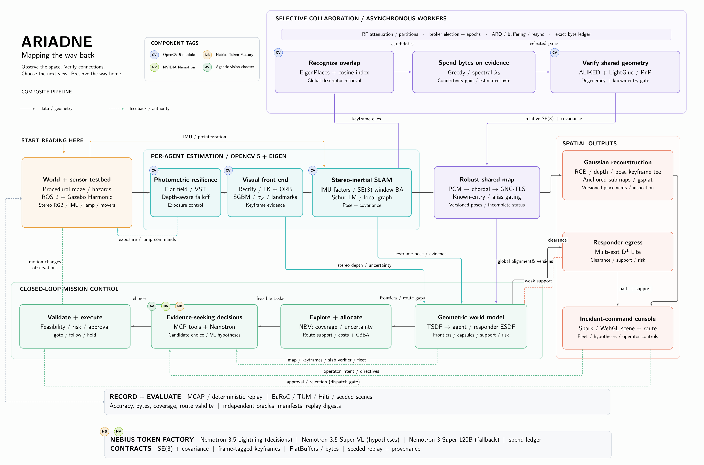
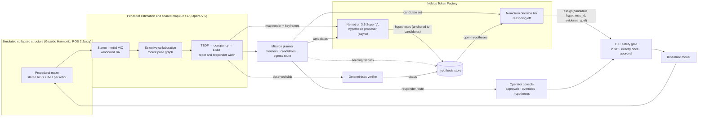

```
            
  :**888H:   .xH""                 @88>               dF
 X   `8▓▓8koXX8▓8       .u    .     %8P               '88bu.         u.    u.
'8hx  4▓█▓8 ?▓▓▓8     .d88B :@8c     .         d.     '*8▓▓88bu    x@88k u@88c.      .u
'8▓88 '▓█▓8 `8▓▓8    ="8▓▓8f8▓▓8r  .@88u     us888u.    ^▓*88▓8N  ^"8▓▓8""8▓▓8"   ud8888.
 %888>'▓▓▓8  8▓▓8      4▓█▓>'88"  ''8▓▓E` .@88 "8▓▓8"  be▓E "8▓8L   8▓▓8  8▓▓R  :888'8▓▓8.
   "8 '▓88"#"8▓▓8      4▓█▓> '      8▓▓E  9▓▓8  9▓▓8   8▓▓E  8▓▓E   8▓▓8  8▓▓R  d▓▓8 '88%"
  .-` X▓"    8▓▓8      4▓█▓>        8▓▓E  9▓▓8  9▓▓8   8▓▓E  8▓▓E   8▓▓8  8▓▓R  8▓▓8.+"
    .xh▓.    8▓▓8     .d▓▓▓L .+     8▓▓E  9▓▓8  9▓▓8   8▓▓E  8▓8F   8▓▓8  8▓▓R  8▓█▓L
  .H88▓▓8h.~`8▓▓8.>   ^"88▓8*"      8▓▓&  9▓▓8  9▓▓8  .8▓▓N..888   "*88*" 8▓88" '8▓▓8c. .+
 .~  `%88!` '888*~       "Y"        R888" "8▓8*d"8▓8"  `"888*""      ""   'Y"    "88▓▓8%
       `"     ""                     ""    ^Y""  ^Y'      ""                      "YP'

```

<h3 align="center">Evidence-Seeking Robot Teams for Collapsed Structures<br/>NVIDIA Nemotron on Nebius Token Factory, over our own multi-agent SLAM and egress stack</h3>

<p align="center">
  
  
  
  
  
  
  
  
</p>

<p align="center">
  <a href="#demo">Demo</a> •
  <a href="#what-it-does">Overview</a> •
  <a href="#nemotron-on-nebius-token-factory">Nemotron on Nebius</a> •
  <a href="#architecture">Architecture</a> •
  <a href="#results">Results</a> •
  <a href="#quick-start">Quick start</a> •
  <a href="#where-things-are">Layout</a>
</p>

---

## Demo

[](https://youtu.be/aoIGG4V3038)

Video (2:53): https://youtu.be/aoIGG4V3038. Also: [results](docs/results/index.md) · [docs map](docs/README.md) ·
[agentic-layer design](docs/design/nemotron-evidence-loop.md)

## Architecture



## What it does

After a structural collapse, the spaces that most need searching are the ones people cannot safely enter: dark,
cluttered, cut off from GPS and from reliable radio. A team of small stereo-camera robots goes in. They:
- map the space together over a lossy, byte-budgeted radio;
- refuse look-alike places that would tear the shared map apart;
- hand incident command a 3D Gaussian-splat model of what they saw, and an egress route checked at
  responder width (a gap a robot fits through is not a route for a person).

Ariadne makes the robots' next moves *evidence-seeking*, with **NVIDIA Nemotron served by Nebius Token Factory** in the loop. Nemotron's
vision model looks at the map the robots built and their camera keyframes, and proposes *hypotheses* about the planner's candidate
goals (for example "this frontier opens onto a passage a responder can use"). On every replan, Nemotron chooses which candidate task each robot takes, and can name the hypothesis that task is meant to test.
A deterministic verifier then settles each hypothesis from the occupancy the robots actually observe, never from the model's own
words. Plain C++ checks every choice before anything moves, and a human approves anything risky.

## Nemotron on Nebius Token Factory

Every model call goes to Nebius Token Factory through its OpenAI-compatible API (`https://api.tokenfactory.nebius.com/v1`). Model
IDs live in `configs/llm/nemotron.yaml`, never in code, and are copied from the endpoint's own `GET /v1/models` listing
([D301](docs/decisions.md)).

| tier | model (Token Factory ID) | when it runs | input → output |
|---|---|---|---|
| **Decision** | `nvidia/Nemotron-3_5-Lightning`, the [bench](evaluation/runs/nemotron/bench_20261028T211611Z/)'s pick ([D319](docs/decisions.md)); `nvidia/nemotron-3-super-120b-a12b` only on a transport error | on every replan, reasoning off (`enable_thinking: false`), at most 512 output tokens | the planner's candidate set and the open hypotheses (MCP tools, incl. `list_hypotheses`) → one `assign` tool call: candidate, `hypothesis_id`, `evidence_goal` |
| **Hypothesis** | `nvidia/Nemotron-3.5-Super-VL` (`vl_proposer: true`); deterministic seeding from the planner's top candidates is the fallback | asynchronously on each replan, off the decision path | the runtime's own map render, the robots' keyframes and the planner's candidates → at most 4 hypotheses through a `propose_hypotheses` tool call, each anchored to a planner candidate (re-associated by centroid). It never sets a status. |

What the model is allowed to do, and what it is not:
- **It chooses; it never certifies.** The decision model picks one of the candidates the deterministic planner produced. The
  unchanged C++ gate (index in set, exactly-once, operator approval above the risk threshold, operator overrides) validates the
  pick before the mover acts. Egress routes come only from the planner (`MissionPlanner::Route`), at responder clearance (0.40 m).
- **Hypothesis status comes only from the verifier.** `python/orchestration/verifier.py` reads the observed occupancy slab and
  moves a hypothesis between `unresolved`, `supported`, `confirmed`, `refuted` and `expired`. The model's text never changes a status,
  and neither does simulator ground truth. *Confirmed* means confirmed on the map at that time: the shared map keeps being revised,
  a later revision can contradict a settled hypothesis, and the console shows when it does (the status itself stays as first
  concluded).
- **No ground truth in any prompt.** The model sees what the robots observed: keyframes, and the occupancy map they built.
- **Spend is capped.** An append-only ledger prices every call from the config and refuses all calls at USD 40 (warning at 25);
  the robots then continue on the classical chooser ([D312](docs/decisions.md)).
- **Every call is logged.** The run trace's `orchestrator` block records provider, model ID, latency and token counts for each
  call. The [G0 calls](evaluation/runs/nemotron/g0_20261028T205925Z/) are the first live examples; the
  [G1 run report](evaluation/runs/nemotron/g1_live-20261028T212942Z-2eda/) walks one hypothesis from proposal to refutation.
- **Failure is visible, not hidden.** A transport error moves to the next model in the chain, and past the chain to the classical
  chooser; each step is counted. A malformed or out-of-set answer is rejected by the gate and counted separately from actions
  executed.

## Architecture



The full design is [`docs/architecture.md`](docs/architecture.md);
each row links to its own design document.

| module | code | what it does |
|---|---|---|
| **World and sensor testbed** | `simulator/`<br>`ros2/`<br>`python/dataset_tools/worldgen/` | Procedural collapsed-structure mazes with hazards, rendered headless (EGL) by Gazebo Harmonic under ROS 2 Jazzy. Each robot carries 1280×720 stereo RGB, a synthesised 200 Hz IMU and a spot lamp. [simulation](docs/design/simulation.md) |
| **Photometric resilience** | `cpp/perception/` | Flat-field correction, variance-stabilising denoising, lamp-falloff normalisation and exposure control; darkness, dust and noise are a seeded operator, so every baseline sees identical pixels. [radiometric](docs/design/radiometric.md) |
| **Visual front end** | `cpp/perception/` | Stereo rectification, FAST/ORB tracked by forward–backward pyramidal LK, SGBM + WLS depth with a per-point σ. [perception](docs/design/perception.md) |
| **Stereo-inertial SLAM** | `cpp/slam/` | Keyframe VIO with IMU preintegration in a 10-keyframe Schur-complement LM window on `cv::detail::LevMarqBase`. [local SLAM](docs/design/local-slam.md), [inertial](docs/design/inertial.md) |
| **Robust shared map** | `cpp/slam/` | Sparse SE(3) pose graph: chordal init, LM, degeneracy gate → PCM → GNC-TLS, an optimality certificate, and the known-entry gate that refuses aliased loops. [pose graph](docs/design/pose-graph.md), [robust back end](docs/design/robust-backend.md) |
| **Selective collaboration** | `cpp/collaboration/`<br>`cpp/runtime/agent/` | EigenPlaces retrieval, spectral-λ₂ selection under a byte budget, ALIKED + LightGlue + PnP verification, an elected broker, and a radio model with partitions. [collaboration](docs/design/collaboration.md) |
| **Geometric world model** | `cpp/planning/` | Voxel-hash TSDF → tri-state occupancy → incremental ESDF at robot and responder width (0.40 m); frontiers, traversability, a structural-risk proxy. [volumetric](docs/design/volumetric.md) |
| **Explore and allocate** | `cpp/planning/mission`<br>`cpp/runtime/live/` | Next-best-view by information gain and event-triggered CBBA produce each robot's feasible candidate tasks. [mission](docs/design/mission.md) |
| **Evidence-seeking decisions** | `python/orchestration/`<br>`configs/llm/` | The Nemotron provider on Token Factory with its spend ledger, the hypothesis store and the deterministic verifier, exposed as MCP tools. [design](docs/design/nemotron-evidence-loop.md), [chooser design](docs/design/agentic.md) |
| **Validate and execute** | `cpp/runtime/tools/ariadne_live.cpp`<br>`simulator/plugins/kinematic_mover/` | C++ validates every choice; approval-gated actions wait for the operator; the mover refuses any goal outside the ESDF safety envelope. [live runtime](docs/design/live-runtime.md) |
| **Responder egress** | `cpp/planning/route` | Responder-width lattice, multi-exit D* Lite, replanned as hazards appear. [egress](docs/design/egress.md) |
| **Gaussian reconstruction** | `python/reconstruction/` | gsplat trains keyframe-anchored submaps on a GPU and moves each when its anchor pose is re-optimised. [reconstruction](docs/design/reconstruction.md) |
| **Incident-command console** | `python/operator_console/` | The splat scene, egress route, fleet state, byte ledger, operator directives and approvals, and the hypotheses panel (status, evidence goal, verifier reason, the deciding model and its latency). [live runtime](docs/design/live-runtime.md) |
| **Record and evaluate** | `cpp/runtime/`, `python/analysis/`, `infra/eval/` | MCAP record/replay with digest checks, a manifest for every run, metrics and gates. [evaluation harness](docs/design/evaluation-harness.md) |

## Results

### Nemotron evidence loop

One 90-second run per policy on one scene (`maze_short_6`), on a CPU-only dev box at about 0.13× real time:
[evaluation/runs/nemotron/f4_20261028T221048Z/](evaluation/runs/nemotron/f4_20261028T221048Z/). **n = 1 each: descriptive, no
ranking claim.**

| | B0 classical | B2 Nemotron | B4 Nemotron + evidence loop |
|---|---|---|---|
| decisions | 36 classical | 36 Nemotron | 34 Nemotron, 2 classical fallbacks |
| mapped free cells at 90 s | 18,984 | 19,061 | 22,668 |
| responder egress route (0.40 m) found | no | no | no |
| unsafe actions executed | 0 | 0 | 0 |
| operator approval requests | 0 | 0 | 3 (unattended: each waited 60 s; 1 fell back) |
| hypotheses | — | — | 25 (12 Super-VL, 13 seeded): 16 confirmed, 3 refuted, 6 supported; first resolution at 10 s; all 9 targeted decisions closed the chain |
| decision latency p50 / p95 (wall clock, loaded box) | — | 5.6 / 9.8 s | 8.0 / 73 s |
| LLM cost, estimated | — | USD 0.072 | USD 0.154 + VL 0.072 |

"Confirmed" means confirmed on the map at that time. Earlier live runs, with worked examples:
[G1](evaluation/runs/nemotron/g1_live-20261028T212942Z-2eda/) (a refutation that re-routes a robot) and
[G2](evaluation/runs/nemotron/g2_live-20261028T214744Z-b93e/) (a risky pick the gate refused).

### Perception, mapping, collaboration and planning

Subsystem results from earlier development runs, with no language model in the loop.

| subsystem | result | comparator |
|---|---|---|
| Inter-agent matching | ALIKED + LightGlue (`cv::dnn`) loop verification: pose AUC@10° **0.607 vs ORB 0.284**, better on **11/11** EuRoC flights | matched baseline ([D63](docs/decisions.md)) |
| Stereo-inertial SLAM | **At or better than ORB-SLAM3 on 7 of 11** EuRoC flights | published (ORB-SLAM3 T-RO 2021) · [runs](evaluation/runs/vio/euroc_full_aws/) |
| Place recognition | EigenPlaces R@1 **0.626** vs mean-bit 0.444 / random 0.167 (EuRoC, 297 queries); across agents in sim R@1 **0.75** | matched baseline · [runs](evaluation/runs/retrieval/) |
| Aliasing-proof merging | Known-entry gate: merged-map error **3.78 m → 1.5 cm**, **0 of 560** true loops rejected (pre-registered, 3 seeds) | gate off vs on · [runs](evaluation/runs/collaboration/known_entry_gate/) |
| ... on recorded live runs | Gate off: 32 of 32 geometry-verified loops were false, one robot ended **15.3 m** off. Gate on: **8/8 refused**, every robot within **7.5 cm** | [gate off](evaluation/runs/collaboration/live_gate_off_20261024_c51ab2/) · [gate on](evaluation/runs/collaboration/live_gate_on_20261024_debba5/) |
| Robust back end | **Certified globally optimal** on **7** public benchmark graphs; PCM→GNC survives up to **90 %** outliers | published (SE-Sync Table 1) · [runs](evaluation/runs/robust-backend/) |
| Task allocation | CBBA reaches **0.994** of the exact optimum (worst 0.983) | exact oracle · [runs](evaluation/runs/planning/allocation_replay/) |
| Egress | **12/12** responder-width routes valid against ground truth; incremental D* Lite equals a fresh search on 180 obstacle-flip rounds | ground truth · [runs](evaluation/runs/egress/) |
| Reconstruction | Gaussian splat on a g4dn GPU: **2.59 M** Gaussians from 3 robots; held-out PSNR **24.36 dB** | [runs](evaluation/runs/reconstruction/) |
| Arm64 | Native Graviton4 build passes **708/708** C++ tests | [run](evaluation/runs/arm64/20261024T100530Z-cpuarm-602802/) |

What does not hold up, and why: [docs/results/index.md](docs/results/index.md) ("do not claim") and
[docs/failure-cases.md](docs/failure-cases.md).

## Quick start

Build, tests, the replay gate and classical live runs need no cloud credentials: the gate replays a committed recording and
`infra/scripts/models.sh` fetches model weights from their public upstream sources.

```bash
./ariadne build                        # pinned images: OpenCV 5 base, core (+ full C++ suite), simulator, orchestrator
./ariadne test                         # C++ suite + reconstruction, world-generation and determinism tests
./ariadne gate                         # end-to-end replay gate, one verdict
./ariadne run maze_short 6 200         # live closed loop in a seeded world (200 s), classical chooser
./ariadne replay <run> <scene>         # replay twice, compare digests
```

With Nemotron in the loop:

```bash
mkdir -p ~/.config/ariadne
(umask 077; printf 'NEBIUS_API_KEY=%s\n' '<your Token Factory key>' > ~/.config/ariadne/nebius.env)   # mode 600
ARIADNE_LIVE_CONFIG=configs/mission/live_llm_v1.yaml ./ariadne run maze_short 6 200
```

`live_llm_v1` sets `chooser: llm`. The orchestrator then reads its model chain, prices and spend cap from
`configs/llm/nemotron.yaml` (override with `ARIADNE_LLM_CONFIG`). The key reaches the orchestrator container only through
`docker --env-file`; no script reads it, and it is never written to a run directory. Spend is appended to
`~/.config/ariadne/nebius_spend.jsonl`.

The decision-tier bench ([D318](docs/decisions.md)) replays recorded chooser requests through each model and scores every answer
with the gate's rules. Its committed result is
[bench_20261028T211611Z/table.md](evaluation/runs/nemotron/bench_20261028T211611Z/table.md). `--dry-run` prints the cost estimate
and stops; without it, the bench makes live Token Factory calls, each one recorded on the spend ledger.

```bash
touch ~/.config/ariadne/nebius_spend.jsonl
docker run --rm -u "$(id -u):$(id -g)" -v "$PWD":/work --env-file ~/.config/ariadne/nebius.env \
  -v ~/.config/ariadne/nebius_spend.jsonl:/spend/nebius_spend.jsonl -e NEBIUS_SPEND_LEDGER=/spend/nebius_spend.jsonl \
  ariadne-orchestrator:nemotron-1 python -m orchestration.bench \
  --corpus evaluation/runs/live-agentic/live_loop/llm_live_run5_maze_short_90s --n 10 --dry-run
```

[docs/build.md](docs/build.md) has every command, the pinned dependencies and the repository layout.

## Compute

| service | role |
|---|---|
| Nebius Token Factory | every Nemotron call (hypothesis and decision tiers) |
| AWS EC2 (spot) | simulator, estimator and GPU runs (c7i.4xlarge CPU, g4dn.xlarge GPU, c8g.4xlarge Graviton4) |
| AWS S3 · ECR · IAM | run inputs and outputs, image registry, least-privilege runner role |
| Amazon Bedrock | an optional alternative provider (`providers/bedrock.py`); not used in any Nemotron result above |

## Where things are

| | |
|---|---|
| [`docs/`](docs/README.md) | architecture, algorithms, design per subsystem, decision log, results |
| [`docs/process/`](docs/process/PHASED_PLAN.md) | plan, register and status for this submission |
| [`evaluation/runs/`](evaluation/README.md) | committed evidence for every claim, by subsystem |
| `cpp/` · `python/` · `ros2/` · `simulator/` · `configs/` · `infra/` · `tests/` | the system |

## Responsible use

This is decision support for incident command in spaces unsafe for people. It maps geometry, traversability, uncertainty and routes,
not people's identities. The language model proposes hypotheses and chooses only among tasks the deterministic planner produced;
every choice is validated in C++, risky actions need human approval, hypothesis status comes from observed geometry, and the
responder route is computed from observed 3D clearance independently of the model. It does not replace structural assessment or
human authority.

## Team

Suvojit Das: design, engineering, evaluation. Submitted to the Nebius × NVIDIA Global AI Hackathon (Physical AI track).

## License

The code and documentation are released under the [MIT License](LICENSE). Third-party components keep their own licences: OpenCV
(Apache 2.0), gsplat (Apache 2.0), and the pretrained models XFeat, ALIKED, LightGlue and EigenPlaces under their upstream licences
(see [docs/algorithms.md](docs/algorithms.md)). Nemotron models are used through Nebius Token Factory under their providers' terms.
