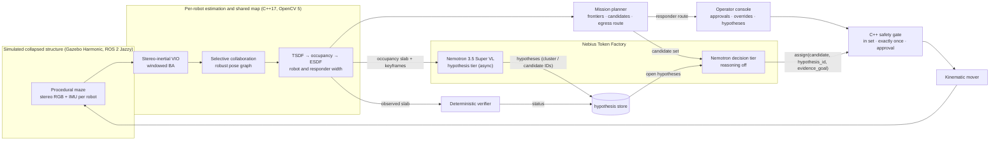

```
            
  :**888H:   .xH""                 @88>               dF
 X   `8▓▓8koXX8▓8       .u    .     %8P               '88bu.         u.    u.
'8hx  4▓█▓8 ?▓▓▓8     .d88B :@8c     .         d.     '*8▓▓88bu    x@88k u@88c.      .u
'8▓88 '▓█▓8 `8▓▓8    ="8▓▓8f8▓▓8r  .@88u     us888u.    ^▓*88▓8N  ^"8▓▓8""8▓▓8"   ud8888.
 %888>'▓▓▓8  8▓▓8      4▓█▓>'88"  ''8▓▓E` .@88 "8▓▓8"  be▓E "8▓8L   8▓▓8  8▓▓R  :888'8▓▓8.
   "8 '▓88"#"8▓▓8      4▓█▓> '      8▓▓E  9▓▓8  9▓▓8   8▓▓E  8▓▓E   8▓▓8  8▓▓R  d▓▓8 '88%"
  .-` X▓"    8▓▓8      4▓█▓>        8▓▓E  9▓▓8  9▓▓8   8▓▓E  8▓▓E   8▓▓8  8▓▓R  8▓▓8.+"
    .xh▓.    8▓▓8     .d▓▓▓L .+     8▓▓E  9▓▓8  9▓▓8   8▓▓E  8▓8F   8▓▓8  8▓▓R  8▓█▓L
  .H88▓▓8h.~`8▓▓8.>   ^"88▓8*"      8▓▓&  9▓▓8  9▓▓8  .8▓▓N..888   "*88*" 8▓88" '8▓▓8c. .+
 .~  `%88!` '888*~       "Y"        R888" "8▓8*d"8▓8"  `"888*""      ""   'Y"    "88▓▓8%
       `"     ""                     ""    ^Y""  ^Y'      ""                      "YP'

```

<h3 align="center">Evidence-Seeking Robot Teams for Collapsed Structures<br/>NVIDIA Nemotron on Nebius Token Factory, over a from-scratch multi-agent SLAM and egress stack</h3>

<p align="center">
  
  
  
  
  
  
  
  
</p>

<p align="center">
  <a href="#demo">Demo</a> •
  <a href="#what-it-does">Overview</a> •
  <a href="#nemotron-on-nebius-token-factory">Nemotron on Nebius</a> •
  <a href="#architecture">Architecture</a> •
  <a href="#results">Results</a> •
  <a href="#quick-start">Quick start</a> •
  <a href="#lineage">Lineage</a>
</p>

---

## Demo

<!-- TODO(FM): YouTube link (under 3:00, at least 60 s of the live application) and a thumbnail without third-party marks. -->
Video: *to be linked.* Also: [results](docs/results/index.md) · [docs map](docs/README.md) ·
[agentic-layer design](docs/design/nemotron-evidence-loop.md)

## What it does

After a structural collapse, the spaces that most need searching are the ones people cannot safely enter: dark,
cluttered, cut off from GPS and from reliable radio. A team of small stereo-camera robots goes in. They:
- map the space together over a lossy, byte-budgeted radio;
- refuse look-alike places that would tear the shared map apart;
- hand incident command a 3D Gaussian-splat model of what they saw, and an egress route checked at
  responder width (a gap a robot fits through is not a route for a person).

This fork adds a reasoning layer on **NVIDIA Nemotron, served by Nebius Token Factory**. A vision-language model looks at what the
robots have mapped and proposes *hypotheses*, such as "this frontier connects to a second exit". The decision model then sends a robot
to the place that would confirm or refute one. A deterministic verifier settles each hypothesis from the occupancy the robots
actually observe, never from the model's own words. Plain C++ checks every choice before anything moves, and a human approves
anything risky.

## Nemotron on Nebius Token Factory

Every model call goes to Nebius Token Factory through its OpenAI-compatible API (`https://api.tokenfactory.nebius.com/v1`). Model
IDs live in `configs/llm/nemotron.yaml`, never in code, and are copied from the endpoint's own `GET /v1/models` listing
([D301](docs/decisions.md)).

| tier | model (Token Factory ID) | when it runs | input → output |
|---|---|---|---|
| **Hypothesis** | `nvidia/Nemotron-3.5-Super-VL` | asynchronously, off the control path | keyframes and the observed occupancy slab (images) → hypotheses anchored to the planner's cluster and candidate IDs, each with an evidence goal |
| **Decision** | `nvidia/nemotron-3-super-120b-a12b` or `nvidia/Nemotron-3_5-Lightning`, whichever the bench selects<!-- TODO(FM): the bench's pick and its table path (evaluation/runs/nemotron/bench_<ts>/) --> | on every replan, reasoning off | the planner's candidate set + open hypotheses → one `assign` tool call (candidate index, `hypothesis_id`, `evidence_goal`) |

What the model is allowed to do, and what it is not:
- **It chooses; it never certifies.** The decision model picks one of the candidates the deterministic planner produced. The
  unchanged C++ gate (index in set, exactly-once, operator approval above the risk threshold, operator overrides) validates the
  pick before the mover acts. Egress routes come only from the planner (`MissionPlanner::Route`), at responder clearance (0.40 m).
- **Hypothesis status comes only from the verifier.** `python/orchestration/verifier.py` reads the observed occupancy slab and
  moves a hypothesis between `unresolved`, `supported`, `confirmed`, `refuted` and `expired`. The model's text never changes a status,
  and neither does simulator ground truth.
- **No ground truth in any prompt.** The model sees what the robots observed: keyframes, and the occupancy map they built.
- **Every call is logged.** The run trace's `orchestrator` block records provider, model ID, latency and token counts for each
  call. The [G0 calls](evaluation/runs/nemotron/g0_20261028T205925Z/) are the first live examples.
- **Failure is visible, not hidden.** A transport error falls back to the classical chooser and is counted. A malformed or
  out-of-set answer is rejected by the gate and counted separately from actions executed.

<!-- TODO(FM): confirm this section against FP's implementation (provider, verifier, ledger cap) once F1/F2 merge. -->

## Architecture



The modules below the agentic layer are Ariadne's, unchanged. The full design is [`docs/architecture.md`](docs/architecture.md);
each row links to its own design document.

| module | code | what it does |
|---|---|---|
| **World and sensor testbed** | `simulator/`<br>`ros2/`<br>`python/dataset_tools/worldgen/` | Procedural collapsed-structure mazes with hazards, rendered headless (EGL) by Gazebo Harmonic under ROS 2 Jazzy. Each robot carries 1280×720 stereo RGB, a synthesised 200 Hz IMU and a spot lamp. [simulation](docs/design/simulation.md) |
| **Photometric resilience** | `cpp/perception/` | Flat-field correction, variance-stabilising denoising, lamp-falloff normalisation and exposure control; darkness, dust and noise are a seeded operator, so every baseline sees identical pixels. [radiometric](docs/design/radiometric.md) |
| **Visual front end** | `cpp/perception/` | Stereo rectification, FAST/ORB tracked by forward–backward pyramidal LK, SGBM + WLS depth with a per-point σ. [perception](docs/design/perception.md) |
| **Stereo-inertial SLAM** | `cpp/slam/` | Keyframe VIO with IMU preintegration in a 10-keyframe Schur-complement LM window on `cv::detail::LevMarqBase`. [local SLAM](docs/design/local-slam.md), [inertial](docs/design/inertial.md) |
| **Robust shared map** | `cpp/slam/` | Sparse SE(3) pose graph: chordal init, LM, degeneracy gate → PCM → GNC-TLS, an optimality certificate, and the known-entry gate that refuses aliased loops. [pose graph](docs/design/pose-graph.md), [robust back end](docs/design/robust-backend.md) |
| **Selective collaboration** | `cpp/collaboration/`<br>`cpp/runtime/agent/` | EigenPlaces retrieval, spectral-λ₂ selection under a byte budget, ALIKED + LightGlue + PnP verification, an elected broker, and a radio model with partitions. [collaboration](docs/design/collaboration.md) |
| **Geometric world model** | `cpp/planning/` | Voxel-hash TSDF → tri-state occupancy → incremental ESDF at robot and responder width (0.40 m); frontiers, traversability, a structural-risk proxy. [volumetric](docs/design/volumetric.md) |
| **Explore and allocate** | `cpp/planning/mission`<br>`cpp/runtime/live/` | Next-best-view by information gain and event-triggered CBBA produce each robot's feasible candidate tasks. [mission](docs/design/mission.md) |
| **Evidence-seeking decisions** (this fork) | `python/orchestration/` | Nemotron hypothesis and decision tiers on Token Factory, the hypothesis store and the deterministic verifier, exposed as MCP tools. [design](docs/design/nemotron-evidence-loop.md), [inherited chooser](docs/design/agentic.md) |
| **Validate and execute** | `cpp/runtime/tools/ariadne_live.cpp`<br>`simulator/plugins/kinematic_mover/` | C++ validates every choice; approval-gated actions wait for the operator; the mover refuses any goal outside the ESDF safety envelope. [live runtime](docs/design/live-runtime.md) |
| **Responder egress** | `cpp/planning/route` | Responder-width lattice, multi-exit D* Lite, replanned as hazards appear. [egress](docs/design/egress.md) |
| **Gaussian reconstruction** | `python/reconstruction/` | gsplat trains keyframe-anchored submaps on a GPU and moves each when its anchor pose is re-optimised. [reconstruction](docs/design/reconstruction.md) |
| **Incident-command console** | `python/operator_console/` | The splat scene, egress route, fleet state, byte ledger, operator directives and approvals, and a hypotheses panel. [live runtime](docs/design/live-runtime.md) |
| **Record and evaluate** | `cpp/runtime/`, `python/analysis/`, `infra/eval/` | MCAP record/replay with digest checks, a manifest for every run, metrics and gates. [evaluation harness](docs/design/evaluation-harness.md) |

## Results

### Nemotron evidence loop (this fork)

<!-- TODO(FM): the F4 matched evaluation (B0 classical, B2 Nemotron without hypotheses, B4 Nemotron with hypotheses; per seed,
descriptive): time to first verified resolution, egress-found time, fallback / invalid / out-of-set rates, gate rejections,
latency p50/p95, tokens, cost. Link evaluation/runs/nemotron/eval_<ts>/. Report negative results as they are. -->
*Pending the matched evaluation.* Every Nemotron number here will link to a run with a manifest and a logged live call.

### Inherited from Ariadne (pre-Nemotron)

These results predate the fork. The agentic row used the earlier Amazon Bedrock chooser, **not Nemotron**
([lineage](evaluation/runs/README.md)).

| subsystem | result | comparator |
|---|---|---|
| Inter-agent matching | ALIKED + LightGlue (`cv::dnn`) loop verification: pose AUC@10° **0.607 vs ORB 0.284**, better on **11/11** EuRoC flights | matched baseline ([D63](docs/decisions.md)) |
| Stereo-inertial SLAM | **At or better than ORB-SLAM3 on 7 of 11** EuRoC flights | published (ORB-SLAM3 T-RO 2021) · [runs](evaluation/runs/vio/euroc_full_aws/) |
| Place recognition | EigenPlaces R@1 **0.626** vs mean-bit 0.444 / random 0.167 (EuRoC, 297 queries); across agents in sim R@1 **0.75** | matched baseline · [runs](evaluation/runs/retrieval/) |
| Aliasing-proof merging | Known-entry gate: merged-map error **3.78 m → 1.5 cm**, **0 of 560** true loops rejected (pre-registered, 3 seeds) | gate off vs on · [runs](evaluation/runs/collaboration/known_entry_gate/) |
| ... on recorded live runs | Gate off: 32 of 32 geometry-verified loops were false, one robot ended **15.3 m** off. Gate on: **8/8 refused**, every robot within **7.5 cm** | [gate off](evaluation/runs/collaboration/live_gate_off_20261024_c51ab2/) · [gate on](evaluation/runs/collaboration/live_gate_on_20261024_debba5/) |
| Robust back end | **Certified globally optimal** on **7** public benchmark graphs; PCM→GNC survives up to **90 %** outliers | published (SE-Sync Table 1) · [runs](evaluation/runs/robust-backend/) |
| Task allocation | CBBA reaches **0.994** of the exact optimum (worst 0.983) | exact oracle · [runs](evaluation/runs/planning/allocation_replay/) |
| Egress | **12/12** responder-width routes valid against ground truth; incremental D* Lite equals a fresh search on 180 obstacle-flip rounds | ground truth · [runs](evaluation/runs/egress/) |
| Agentic loop (Bedrock era) | **80/80** Bedrock decisions validated, **0/80** approval-gated picks, the mover refused 3 unsafe goals | [run](evaluation/runs/live-agentic/final_stack_e2e/) |
| Reconstruction | Gaussian splat on a g4dn GPU: **2.59 M** Gaussians from 3 robots; held-out PSNR **24.36 dB** | [runs](evaluation/runs/reconstruction/) |
| Arm64 | Native Graviton4 build passes **708/708** C++ tests | [run](evaluation/runs/arm64/20261024T100530Z-cpuarm-602802/) |

What does not hold up, and why: [docs/results/index.md](docs/results/index.md) ("do not claim") and
[docs/failure-cases.md](docs/failure-cases.md).

## Quick start

Everything except the Nemotron tier runs without credentials.

```bash
./ariadne build                        # pinned images: OpenCV 5 base, core (+ full C++ suite), simulator, orchestrator
./ariadne test                         # C++ suite + reconstruction, world-generation and determinism tests
./ariadne gate                         # end-to-end replay gate, one verdict
./ariadne run maze_short 6 200         # live closed loop in a seeded world (200 s), classical chooser
./ariadne replay <run> <scene>         # replay twice, compare digests
```

With Nemotron: put your Token Factory key in `~/.config/ariadne/nebius.env` (mode 0600, outside the repository). It is passed to the
orchestrator container at run time only and never written to a run directory.

<!-- TODO(FM): the exact live command with the Nemotron provider (live.sh start_orchestrator --env-file, F1.4) and the
zero-credential bench replay (python -m orchestration.bench over the recorded corpus, F1.5). -->

[docs/build.md](docs/build.md) has every command, the pinned dependencies and the repository layout.

## Compute

| service | role |
|---|---|
| Nebius Token Factory | every Nemotron call (hypothesis and decision tiers) |
| AWS EC2 (spot) | simulator, estimator and GPU runs (c7i.4xlarge CPU, g4dn.xlarge GPU, c8g.4xlarge Graviton4) |
| AWS S3 · ECR · IAM | run inputs and outputs, image registry, least-privilege runner role |
| Amazon Bedrock | optional legacy comparator only (`providers/bedrock.py`); the pre-fork chooser |

## Lineage

This repository is a fork of Ariadne with shared git history ([D300](docs/decisions.md)). Everything below the agentic layer —
estimation, collaboration, mapping, planning, the C++ safety gate, reconstruction — is Ariadne's. The fork adds the Nemotron
provider, the hypothesis store, the verifier, the bench and the console's hypotheses panel. Runs under `evaluation/runs/` that
predate the fork are Bedrock-era evidence, labelled as such in [evaluation/runs/README.md](evaluation/runs/README.md).

| | |
|---|---|
| [`docs/`](docs/README.md) | architecture, algorithms, design per subsystem, decision log, results |
| [`docs/process/`](docs/process/PHASED_PLAN.md) | the fork's plan, register and status |
| [`evaluation/runs/`](evaluation/README.md) | committed evidence for every claim, by subsystem |
| `cpp/` · `python/` · `ros2/` · `simulator/` · `configs/` · `infra/` · `tests/` | the system |

## Responsible use

This is decision support for incident command in spaces unsafe for people. It maps geometry, traversability, uncertainty and routes,
not people's identities. The language model proposes hypotheses and chooses only among tasks the deterministic planner produced;
every choice is validated in C++, risky actions need human approval, hypothesis status comes from observed geometry, and the
responder route is computed from observed 3D clearance independently of the model. It does not replace structural assessment or
human authority.

## Team

Suvojit Das: design, engineering, evaluation. Built on Ariadne for the Nebius × NVIDIA Global AI Hackathon (Physical AI track).

## License

The code and documentation are released under the [MIT License](LICENSE). Third-party components keep their own licences: OpenCV
(Apache 2.0), gsplat (Apache 2.0), and the pretrained models XFeat, ALIKED, LightGlue and EigenPlaces under their upstream licences
(see [docs/algorithms.md](docs/algorithms.md)). Nemotron models are used through Nebius Token Factory under their providers' terms.
